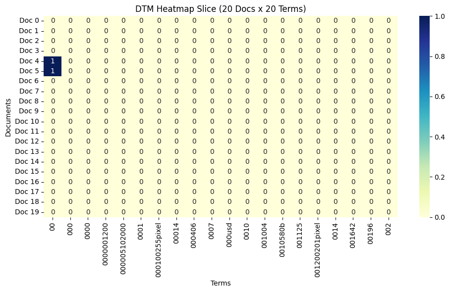
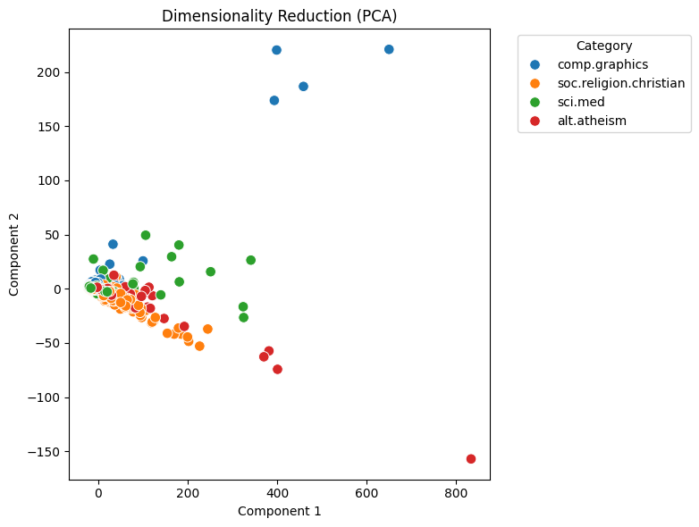

# DM2026 Lab 1: Agentic Pipeline Report

**Name:** 沈妤庭  
**Student ID:** 5114064404

I analyzed 2,257 posts from the 20-newsgroups subset containing `alt.atheism`, `comp.graphics`, `sci.med`, and `soc.religion.christian` (`load_dataset_1`). `inspect_data_2` showed three columns: `text`, `category`, and `category_name`. `check_missing_3` found no missing text, and `check_duplicates_4` reported no duplicate rows, so I kept all posts. `binarize_labels_10` converted the labels to one-hot form, with `sci.med` in the third column (index 2). I chose this class for the correlation analysis.

`build_dtm_6` produced a 2,257 × 35,788 document-term matrix with 99.547% zero entries. I kept this matrix as the baseline. Although I had requested `stop_words="english"`, the tool did not support that parameter. In `term_frequency_7`, “the” occurred 29,825 times and “of” occurred 17,660 times, showing that common stop words remained. The 20 × 20 slice in `dtm_heatmap_8` was all zero except two cells with a value of 1, and its terms were mostly number-based tokens such as “00” and “000usd”. This plot shows a small part of the matrix and gives limited information about the main topics.

`variance_filter_9` kept 5,354 terms at threshold 0.01, but high-variance stop words such as “the” remained. For `sci.med`, `pearson_filter_11` kept 267 terms and `spearman_filter_12` kept 354 at threshold 0.1. Eight of their top ten terms overlapped. Both ranked “pitt” first, while Spearman’s top ten also included “disease” and “medical”. Some high-scoring terms may reflect author or institution information, so I would not automatically treat them as medical keywords. The returned summaries did not confirm whether the threshold used signed coefficients or their absolute values.

I first requested FP-Growth for `sci.med` with `filtering_method="tfidf"`, `k=10`, and `min_sup=5`. The call failed with a `MemoryError`. A later call with `filtering_method="term_frequency"`, `k=5`, and `min_sup=50` completed and returned zero patterns (`mine_patterns_13`). Both the selection method and parameters changed, so I cannot tell which change avoided the error. The zero-pattern result applies only to this configuration; it does not show that `sci.med` posts have no co-occurring words. The agent described `k` as the number of top terms selected, but the unit of `min_sup` (document count or proportion) was not stated.

`reduce_dimensions_14` ran PCA with `n_components=2` on all 2,257 posts. The first two components explained 65.94% and 4.33% of the variance, about 70.27% combined from the returned ratios. Most points overlapped near the origin, with a few distant points, so the plot did not show clear separation of all four classes. Finally, `cosine_sim_15` compared posts 0 and 1, both labelled `comp.graphics`, and returned a cosine similarity of about 0.353. This result describes only the similarity between those two word-frequency vectors.

