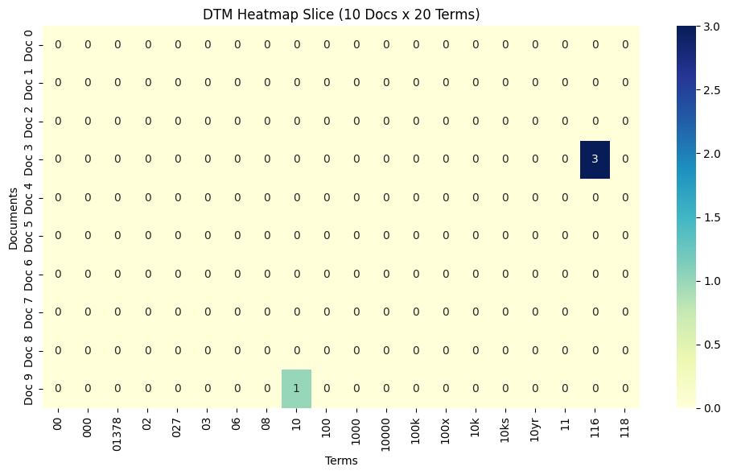
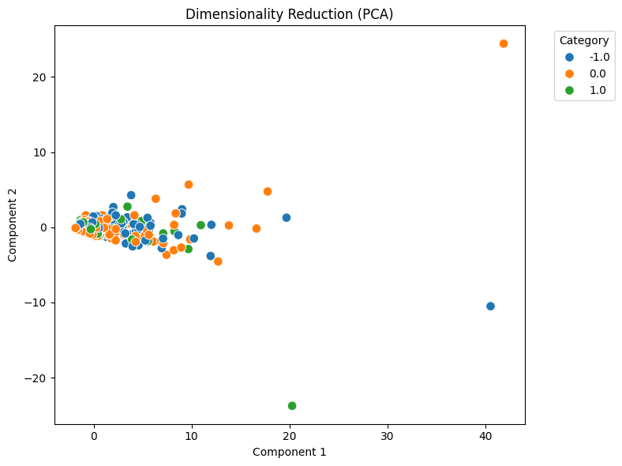

# DM2026 Lab 1 Homework Report: Reddit Stock Sentiment Data

The Reddit stock sentiment dataset (`newdataset/Reddit-stock-sentiment.csv`) was loaded with `text` as the text column and `label` as the label column. `load_dataset_1` returned 847 documents: 423 neutral (0.0), 315 negative (−1.0) and 109 positive (1.0), so the positive class is much smaller than the other two. `inspect_data_2` showed three columns: `text`, `category_name` and `category`. `check_missing_3` found no missing or empty text. With `drop=False`, `check_duplicates_4` reported `duplicate_count = 23`. With `drop=True`, `check_duplicates_5` reported `rows_dropped = 34`, which left 813 documents. These are two different fields, and the output does not explain how each one is counted. The class counts above are from before deduplication; counts after it were not returned. `tokenize_6` then split the 813 documents into 25,287 tokens, and the preview shows that punctuation such as `?` and `.` was kept as tokens.

`build_dtm_7` was requested with `ngram_range=[1,1]`, `min_df=1` and `max_df=1.0`; its output reported a vocabulary of 2,654 terms. `build_dtm_8` was re-run with the same requested parameters as a check and returned the same numbers. Following an AI suggestion, `max_df` was then left out so that the tool would use its default value. `build_dtm_9` returned an 813 × 4,313 matrix with 99.5249% sparsity, and it was set as the baseline for the later steps. The outputs do not show why `build_dtm_7`/`_8` and `build_dtm_9` differ, so `build_dtm_9` is the chosen baseline, not a version proven to be more correct. `term_frequency_10` lists the top 20 terms, which are mostly English function words, such as "the" (874), "to" (554), "and" (471) and "is" (386). This list alone is not enough to describe the stock topics or to separate the sentiment classes. `dtm_heatmap_11` shows the first 10 documents and the first 20 terms in vocabulary order, not the 20 most frequent terms. These 20 terms are numeric or alphanumeric tokens, such as "00", "000", "100k" and "10yr". In this 10 × 20 slice, 198 of the 200 cells are 0; only Doc 3 has "116" = 3 and Doc 9 has "10" = 1.

`variance_filter_12` (`threshold=0.01`) kept 490 of the 4,313 features. The highest variances still belonged to function words such as "the" (5.134592), "to" (2.175264) and "and" (1.783681), so a variance filter alone keeps many common words that may not be related to the classes. Pearson and Spearman filters were then run for the positive class with `target_class="1.0"` and `threshold=0.0`. `pearson_filter_13` kept 992 features, with "main", "huge" and "tldr" tied at the top (0.156325). `spearman_filter_14` kept 1,004 features; "technology" ranked first (0.160911), followed by "main", "huge" and "tldr" (0.156325). Both outputs report `total_features = 4,313`, so the correlations were computed on the full vocabulary, not on the 490 variance-filtered terms. The two rankings largely overlap, but the highest coefficient is only about 0.16. These terms show a weak association with the positive class, not a verified ability to identify it.

Pattern mining also focused on the positive class, with `category_name="1.0"`, `filtering_method="tfidf"` and `algorithm="fpgrowth"`. According to the tool description, this tool builds its own DTM with English stop words removed and does not use the `spearman_filter_14` result. With `min_sup=5`, `mine_patterns_15` found 16 patterns, all single words. Examples include "just" (15), "good" (12) and "doing" (9), as well as market-related words such as "economy" (6), "tariffs", "silver" and "market" (5 each). No word combination reached this threshold. `min_sup` was then lowered to 3 to look at less frequent co-occurrences. `mine_patterns_16` found 87 patterns but returned only the top 50. The visible multi-word patterns are [main, just], [points, just], [points, main], [just, points, main] and [tldr, technology], each with a support of 3. "Main", "points", "tldr" and "technology" also rank high in the correlation results. Patterns 51–87 were not returned, so the full set of patterns cannot be described.

PCA was requested with `n_components=2` and `random_state=42`; `reduce_dimensions_17` returned two-dimensional coordinates for 813 samples. PC1 explains 26.7007% of the variance and PC2 explains 5.1242%, for a total of 31.8249%. In the plot, most points sit near the origin and the three classes overlap heavily, with only a few points far from the center. The two components keep only about a third of the variance, so this result applies only to this 2D projection. It does not show that the original features cannot separate the classes, and the reason for the overlap was not tested.

